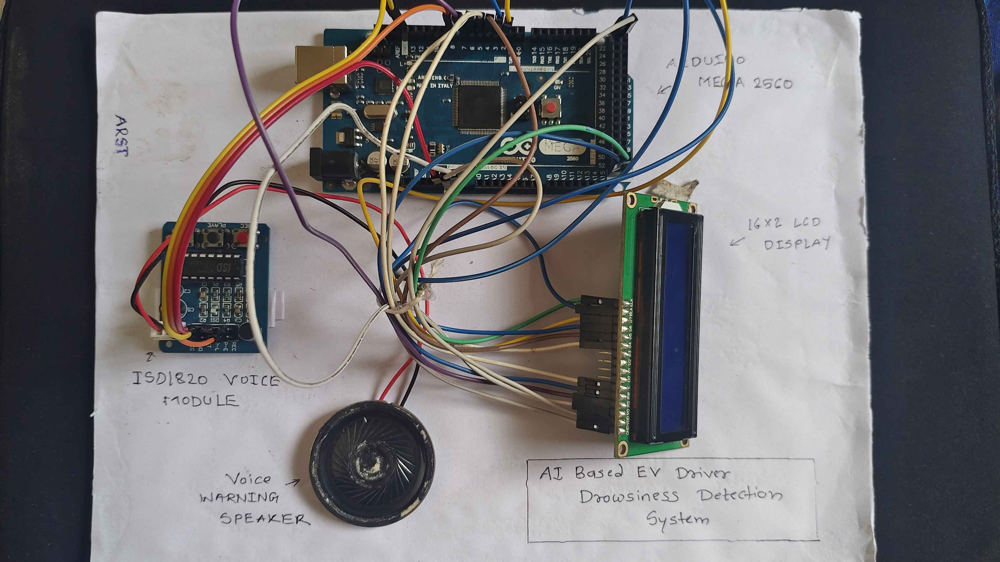

# 🚗 AI-Based EV Driver Drowsiness Detection System

An AI-assisted driver safety system that detects signs of drowsiness using a laptop webcam and alerts the driver through an LCD display and a voice warning module.


[View Releases](https://github.com/arst24/EV-Driver-Drowsiness-Detection/releases)

## 📌 Project Overview

Driver drowsiness can reduce reaction time and increase the risk of road accidents. This project combines Python-based facial landmark detection with an Arduino-controlled warning system to demonstrate a low-cost driver alert solution.

## ✨ Features

- Real-time webcam-based eye monitoring
- Facial landmark detection using MediaPipe
- Eye Aspect Ratio (EAR)-based drowsiness detection
- Arduino Mega 2560 integration
- 16×2 LCD status display
- ISD1820 voice warning module
- Serial communication between Python and Arduino

## ⚙️ System Architecture

**Laptop Webcam → Python + MediaPipe → Serial Communication → Arduino Mega 2560 → LCD + Voice Alert**

## 🧰 Hardware Used

- Arduino Mega 2560
- 16×2 LCD
- ISD1820 voice recording/playback module
- Speaker
- Laptop webcam
- Breadboard and jumper wires

## 💻 Software Used

- Python
- OpenCV
- MediaPipe
- pySerial
- Arduino IDE

## 🔄 Working Principle

1. The webcam captures the driver's face.
2. MediaPipe identifies facial landmarks around the eyes.
3. Python calculates the Eye Aspect Ratio to estimate whether the eyes are closed.
4. If the eyes remain closed beyond the configured time threshold, the system identifies a potential drowsiness event.
5. Python sends the status to the Arduino Mega through serial communication.
6. The LCD displays a warning, and the voice module plays an alert.

## 🎯 Applications

- Driver safety demonstrations
- Automotive embedded-system prototypes
- Student projects in AI and electrical engineering
- Learning applications involving computer vision and microcontrollers

## ⚠️ Limitations

This is an educational prototype, not a certified automotive safety device. It can produce false alerts and should not replace proper rest or commercial driver-monitoring systems.

## 👨‍💻 Author

**Mohak Yashpal Lohi (ARST)**

## 📸 Project Gallery

### 1. Hardware Setup


### 2. System Ready


### 3. Driver Awake — Python Detection


### 4. Drowsiness Detected — Python


### 5. Driver Awake — Hardware Display


### 6. Drowsiness Warning — Hardware Display


### 7. Face Not Detected — Python


### 8. Face Not Detected — Hardware


## ⚙️ System Architecture

The system combines Python-based AI vision processing with an Arduino-controlled warning system.

```text
          LAPTOP WEBCAM
                |
                v
       PYTHON + OPENCV
                |
                v
    MEDIAPIPE FACE LANDMARKS
                |
                v
       EYE ASPECT RATIO
                |
                v
     DROWSINESS DETECTION
                |
        USB SERIAL (COM3)
                |
                v
       ARDUINO MEGA 2560
          /           \
         v             v
     16×2 LCD      ISD1820 MODULE
   AWAKE/DROWSY      + SPEAKER
                         |
                         v
                  VOICE WARNING
```

### How It Works

1. The laptop webcam captures the driver's face.
2. Python processes the video using OpenCV and MediaPipe.
3. Eye landmarks are used to calculate the Eye Aspect Ratio (EAR).
4. If the eyes remain closed for approximately 2 seconds, the system detects possible drowsiness.
5. Python sends the detection status to the Arduino Mega through serial communication.
6. The Arduino updates the LCD and triggers the ISD1820 module to play the recorded voice warning.
7. When the eyes reopen, the system returns to the awake state.

**Note:** The AI vision processing runs on the laptop. The Arduino handles the LCD and voice-warning hardware.

## 🔌 Hardware Components

| Component | Purpose |
|---|---|
| Arduino Mega 2560 | Controls the LCD and voice-warning module |
| Laptop webcam | Captures the driver's face |
| 16×2 LCD | Displays system status and warnings |
| ISD1820 voice module | Plays the pre-recorded warning message |
| 8Ω / 16Ω speaker | Outputs the voice warning |
| Breadboard and jumper wires | Provide circuit connections |
| Laptop / PC | Runs Python and AI vision processing |
| USB cable | Powers the Arduino and enables serial communication |

## 🔗 Hardware Connections

### 16×2 LCD to Arduino Mega 2560

| LCD Pin | Arduino Connection |
|---|---|
| RS | Digital pin 7 |
| E | Digital pin 6 |
| D4 | Digital pin 5 |
| D5 | Digital pin 4 |
| D6 | Digital pin 3 |
| D7 | Digital pin 2 |
| VSS | GND |
| VDD | 5V |
| RW | GND |
| VO | GND for temporary contrast setup |

### ISD1820 Voice Module

| ISD1820 Pin | Connection |
|---|---|
| VCC | 5V |
| GND | GND |
| Playback trigger input | Arduino digital pin 8 |
| SP+ / SP− | Speaker terminals |

**Important:** Use a common ground between the Arduino and voice module. Connect the speaker only to the ISD1820 speaker terminals, never directly to Arduino pins.

## 💻 Software and Communication

- **Python:** Main detection program
- **OpenCV:** Webcam and video processing
- **MediaPipe:** Facial landmark detection
- **pySerial:** Sends status messages to the Arduino
- **Arduino IDE:** Uploads the hardware-control sketch
- **Serial communication:** COM3 at 9600 baud in the tested setup

*Note: The speaker impedance should match the module's supported specifications. A 16Ω speaker may produce lower volume than an 8Ω speaker.*

## 🚀 Installation and Setup

### 1. Requirements

- Python 3.13
- Arduino Mega 2560
- Laptop webcam
- 16×2 LCD
- ISD1820 voice playback module and speaker
- Arduino IDE

### 2. Install Python Libraries

Open Command Prompt in your project folder and run:

```bash
python -m pip install opencv-python mediapipe pyserial
```

### 3. Connect the Hardware

Connect the LCD and ISD1820 module according to the hardware connections documented above. Connect the Arduino Mega to the laptop using a USB cable.

### 4. Upload the Arduino Program

1. Open the Arduino sketch in Arduino IDE.
2. Select **Arduino Mega or Mega 2560** as the board.
3. Select the correct COM port.
4. Upload the sketch.
5. Close the Arduino Serial Monitor before running the Python program.

### 5. Configure the Python Program

Ensure that the following files are in the correct locations:

- `ev_drowsiness_system.py`
- `face_landmarker.task`

Check that the serial port in the Python code matches your Arduino's COM port. The tested configuration used `COM3` at `9600` baud.

### 6. Run the System

Run the Python program from Command Prompt:

```bash
python ev_drowsiness_system.py
```

Allow webcam access when prompted. Keep your face visible to the camera and test the awake and drowsiness-warning states in a safe, stationary setup.

### ⚠️ Important Notes

- The Arduino sketch must be uploaded before starting the Python program.
- The `face_landmarker.task` model file must be available at the path specified in the Python script.
- COM port names may differ between computers.
- This is an educational prototype, not a certified automotive safety system.

## ⚠️ Limitations

- The system requires a laptop or PC to process webcam video and run the detection model.
- Detection accuracy can be affected by poor lighting, camera angle, glasses, or face movement.
- Eye closure is used as an indicator of possible drowsiness; it does not medically confirm that a driver is sleepy.
- The prototype has not been certified or tested for real-world vehicle safety.
- The recorded voice warning depends on the ISD1820 module, speaker, and power supply.

## 🔮 Future Improvements

- Integrate a compact camera and embedded AI processor.
- Improve detection under different lighting conditions.
- Add head-pose and yawning detection.
- Include a mobile notification or dashboard alert.
- Improve warning audio clarity and volume.
- Test the system across more users and driving-like conditions in a controlled environment.

## 🏁 Conclusion

This project demonstrates a low-cost driver drowsiness warning prototype using computer vision, facial landmarks, an Arduino Mega, an LCD, and a voice playback module. It combines software-based detection with physical alerts to demonstrate how technology can help identify signs of driver fatigue.

## 📁 Repository Structure

```text
EV-Driver-Drowsiness-Detection/
├── docs/
│   └── images/
├── README.md
├── .gitignore
├── requirements.txt
├── ev_drowsiness_system.py
├── ev_drowsiness_arduino.ino
├── face_landmarker.task
├── camera_test.py
└── eye_test.py
```

- `ev_drowsiness_system.py` — Main Python-based drowsiness detection program.
- `ev_drowsiness_arduino.ino` — Arduino sketch for LCD and voice-warning control.
- `face_landmarker.task` — Pretrained MediaPipe face landmark model.
- `camera_test.py` — Webcam testing utility.
- `eye_test.py` — Eye detection testing utility.
- `requirements.txt` — Python dependencies.
- `docs/images/` — Project photos and screenshots.

## 👨‍💻 Author

Developed as an educational project.

## © Copyright

Copyright © 2026. All rights reserved.

This project is shared for viewing and educational reference only. No permission is granted to copy, modify, redistribute, or use this code without prior written permission from the author.
